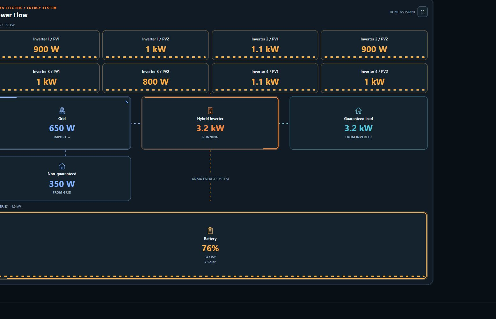
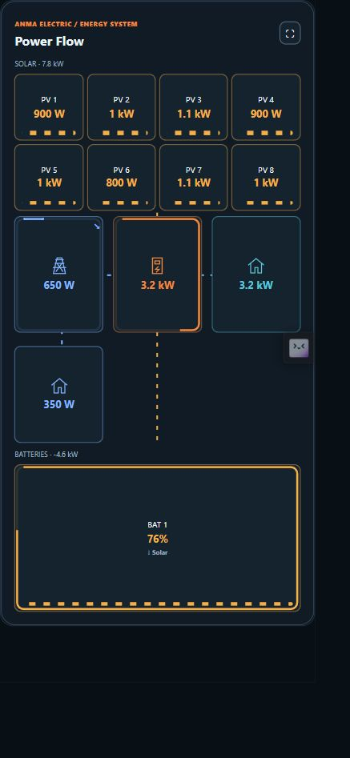
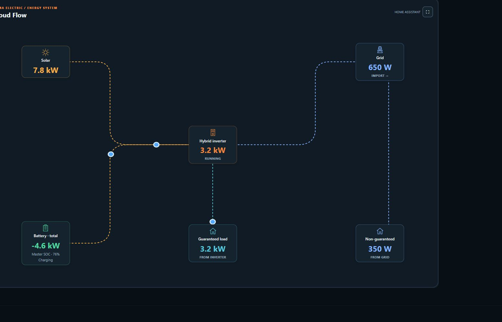
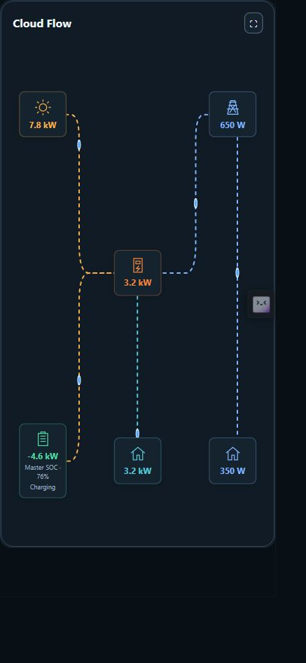
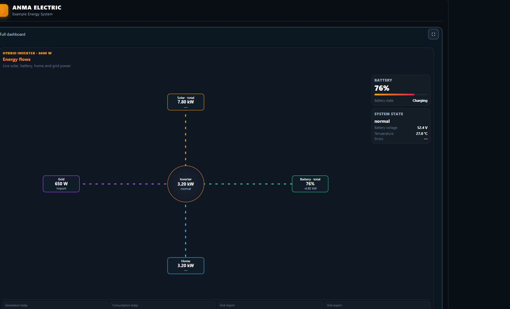
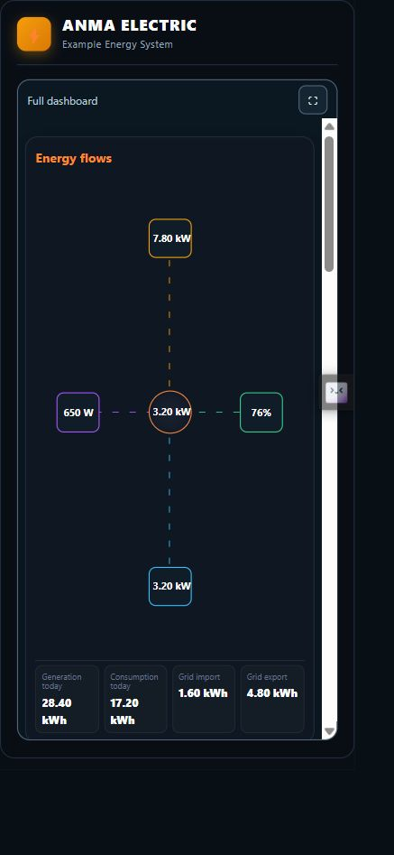

# ANMA Energy Dashboards

Responsive energy dashboards for Home Assistant: solar generation, battery storage, grid exchange and household consumption in one custom card.

**Stable release: 0.3.0.** This is the standalone dashboard distribution from ANMA Energy Platform. It does not replace the platform, install a Django server or create sensor integrations. Connect your existing Home Assistant entities to the supplied layouts.

## Explore ANMA Energy Platform

**[Open ANMA Energy Platform](https://app.anma-electric.com.ua/)** — the online home of the ANMA tools.

Use the website to explore electrical equipment, compare products, build an energy system and design dashboards:

- **Equipment Knowledge Base:** a searchable technical reference for inverters, batteries, PV modules, meters, EV chargers and other electrical equipment, with specifications and source information.
- **Compare:** compare equipment specifications when choosing components.
- **System Builder:** assemble and configure your energy-system project.
- **Dashboards:** create and customize energy views for monitoring your system.

This repository provides the Home Assistant dashboard card. The hosted website provides the broader ANMA platform; its account and feature access conditions are shown on the site.

## Dashboard styles

| Style | Purpose |
| --- | --- |
| ANMA Power Flow | Individual PV groups, battery blocks, grid, inverter and backed-up/non-backed-up loads. Up to 10 PV groups and 5 batteries. |
| ANMA Cloud Flow | Six-node diagram with directional paths: solar, grid, inverter, batteries, backed-up load and non-backed-up load. |
| Energy flows | Editable energy-flow layout and key measurements. |
| Compact indicators | A compact collection of metric tiles. |
| Full system analytics | A scrolling composition of energy flows, compact indicators, weather, solar forecast and a power chart. |

Power Flow supports manual power values or sensor bindings, maximum-power perimeter indicators and matching flow speed. Grid and battery signs can be inverted. Battery discharge is green; known solar charging is yellow; known grid charging is blue. An unknown charging source remains unknown: solar generation alone does not prove that the battery is charging from solar.

Layouts adapt to desktop, tablet and phone. Mobile views reduce labels, use compact controls and arrange metric/forecast tiles in two columns. Full analytics combines blocks in one scrolling view. Fullscreen belongs to the overall view rather than each child block.

## Make it yours

Add a **whole-card background image** to Power Flow or Cloud Flow: upload a photo or paste an image URL, choose its position and cover/contain fit, then adjust visibility from 0 to 100%. Cover fills the card and crops excess edges without stretching the image. The background never moves the diagram or blocks its controls.

Inverter and battery photos are independent backgrounds: equipment icons and readings stay visible above them. Existing entity bindings and dashboard layouts are preserved when updating.

Power Flow automatically balances up to ten PV groups across two full-width rows: **3 → 2+1, 7 → 4+3, 8 → 4+4, 10 → 5+5**. One group fills the solar area.

## Desktop and phone gallery

Fresh captures from the actual 0.2.0 card with synthetic demonstration states. Mobile screenshots use a **393 × 852 CSS-pixel viewport**, matching iPhone 16 portrait dimensions; these are browser previews, not physical-device or Safari certification. See [the gallery](docs/SCREENSHOTS.md).

### ANMA Power Flow

On phones, short PV/battery labels and primary readings take priority. Secondary names, status text and technical details are reduced or hidden in compact mode, keeping the energy diagram readable. Sensor bindings remain unchanged.

### ANMA Cloud Flow

On phones, node icons and values remain visible while long equipment names and secondary status labels are hidden. Directional paths keep the flow relationship clear.

### Full system analytics

Full analytics is one scrollable dashboard. On phones, metric and forecast tiles use compact layouts and chart legends reduce text. History and forecast values require the corresponding Home Assistant data services; the preview does not invent missing history.

## Install

The file to install is **`anma-card.js` in the root of this repository**. Do not install the source modules separately. Do not register both an old ANMA resource and this resource.

### HACS custom repository

1. Publish this repository as `lovelace-anma-card` (see [publishing](docs/PUBLISHING.md)).
2. In HACS, open the menu, choose **Custom repositories**, paste your public repository URL and choose **Dashboard** (called `plugin` internally).
3. Find ANMA Energy Dashboards and download it.
4. Check Home Assistant's dashboard resources. For a repository named `lovelace-anma-card`, the resource is normally `/hacsfiles/lovelace-anma-card/anma-card.js`, type **JavaScript module**. Add it only if HACS did not register it.
5. Reload the browser, then add a Manual card or import the three-view example below.

This package has not yet been accepted into the default HACS catalog. Custom repository installation and default catalog inclusion are separate steps. [Official custom-repository instructions](https://hacs.dev/docs/faq/custom_repositories/).

### Manual installation

1. Copy the root `anma-card.js` to `/config/www/anma-card.js` on Home Assistant.
2. In Settings → Dashboards → Resources (enable Advanced mode if needed), add `/local/anma-card.js?v=0.3.0` as a **JavaScript module**.
3. Reload the browser. On updates, replace the same file and change the query version to refresh the cache.
4. Keep only one ANMA resource registration. No database migration is required for this frontend card.

## Create your dashboard

Create a new empty dashboard, take control if prompted, then open its raw configuration editor. Paste [`examples/three-tab-dashboard.yaml`](examples/three-tab-dashboard.yaml). It creates Power Flow, Cloud Flow and Full System Analytics views. Replace the illustrative entity IDs in **each** view with your own; the examples do not provision sensors.

For one card, paste any `*-card.yaml` example into a Manual card editor. Read [configuration](docs/CONFIGURATION.md) before connecting production readings. Save the Home Assistant dashboard configuration after editing; browser preview changes are not a substitute for saving the dashboard.

## Requirements and limits

- Existing Home Assistant entities with correct measurement units. Power and energy are different quantities.
- Modern browser with CSS container queries. Fullscreen may depend on browser and device support.
- Historical charts need Home Assistant Recorder history/statistics for the configured entities. Weather and solar forecasts need their own integrations and data.
- Preview/demo charts may be shown when no live bindings are available. Confirm labels and sensor bindings before interpreting any chart as real telemetry.
- This is a visualization, not an inverter controller or an electrical protection system.
- The ANMA web builder is part of ANMA Energy Platform; it is not included as a hosted service in this frontend package.

## Maintainers

See [publishing and releases](docs/PUBLISHING.md), [configuration](docs/CONFIGURATION.md), [validation](docs/VALIDATION.md) and [changes](CHANGELOG.md).

## License

Licensed under the [MIT License](LICENSE). Copyright (c) 2026 Anton Babenko and ANMA contributors.

Project website: [ANMA Energy Platform](https://app.anma-electric.com.ua/).

## New in 0.3.0

Every Power Flow and Cloud Flow node supports its own background photo. Panel opacity defaults to 40% and can be adjusted independently from photo visibility. PV entity pickers are beside the PV equipment; bindings survive later edits. Signed grid power selects import/export direction automatically in single-sensor mode. See [the changelog](CHANGELOG.md) for full release notes.
