# ANMA Energy Dashboards

**Solar, storage, grid and home — one card, six views.**

Design on [ANMA Energy Platform](https://app.anma-electric.com.ua/), connect your Home Assistant entities and export your layout. Install **one HACS package** and use **`custom:anma-card`** for every view.

**Latest release: 0.7.0** · [Download](https://github.com/bobantonbob/lovelace-anma-card/releases/latest) · [Configuration](docs/CONFIGURATION.md) · [Changelog](CHANGELOG.md)

## Start with Energy Station

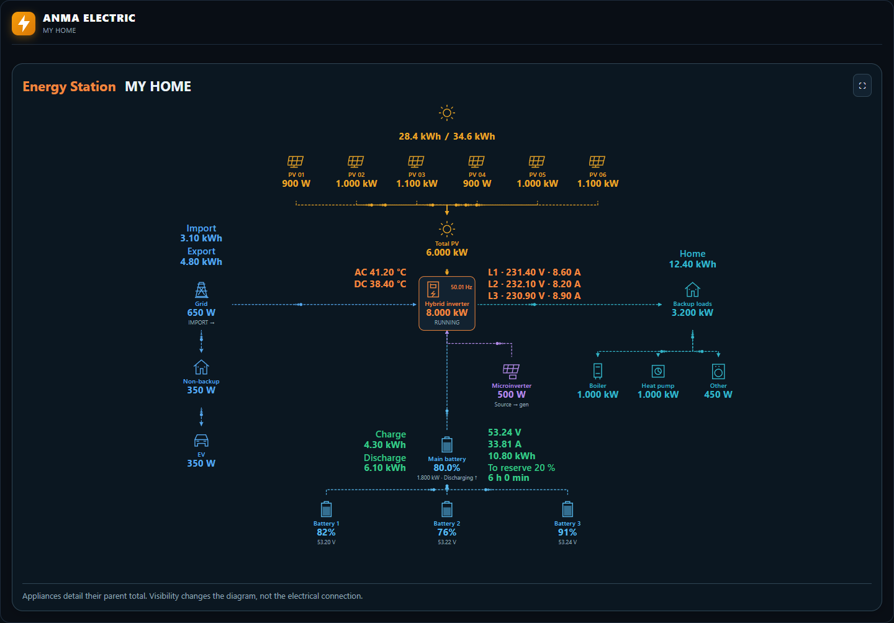

Energy Station combines up to **10 PV fields, 5 batteries, GEN/AUX and configurable load groups**. Read battery SOC and decimal voltage, daily import/export, house consumption, inverter diagnostics, and available battery energy above your chosen reserve.

- Actual solar production and today's forecast are separated by a centered slash.
- Choose single-phase or three-phase inverter readings and your own flow colors.
- Battery reserve runtime uses actual battery discharge power.
- Place EVs and other appliances in backup or non-backup groups.
- GEN/AUX supports microinverter input, generator input, smart-load output or disabled.
- Visible equipment rows recenter when their count changes.
- Set a custom system title and background opacity; telemetry stays beside its device.

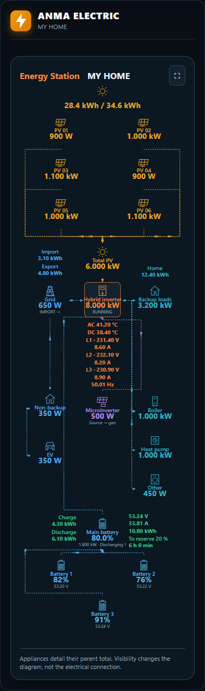

[Energy Station example](examples/energy-station.yaml)

## New in 0.7.0: architectural Cloud Flow

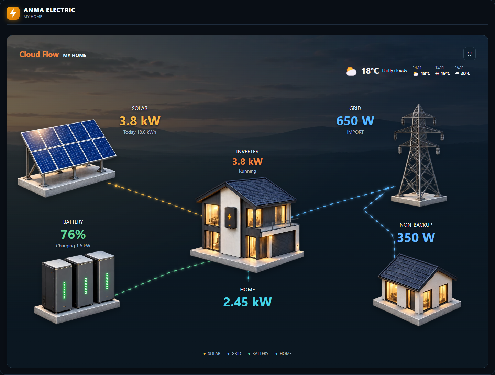

Cloud Flow now presents energy as a restrained dimensional scene: solar panels, a transmission pylon, a compact home with inverter, battery cabinets and non-backup supply. The values and directional paths are live interface elements above the illustrated objects.

**Weather follows your Home Assistant provider.** Select a current-weather entity for conditions, temperature and background effects. Select a separate forecast entity, or leave it empty to use the current-weather entity. Choose hourly, daily or day/night forecasts when your provider supports them. Rain, snow, cloud haze and sunlight sit behind the data; effects can be disabled or softened.

The phone layout rearranges the sources, house, battery and non-backup supply. It does not simply shrink the desktop diagram.

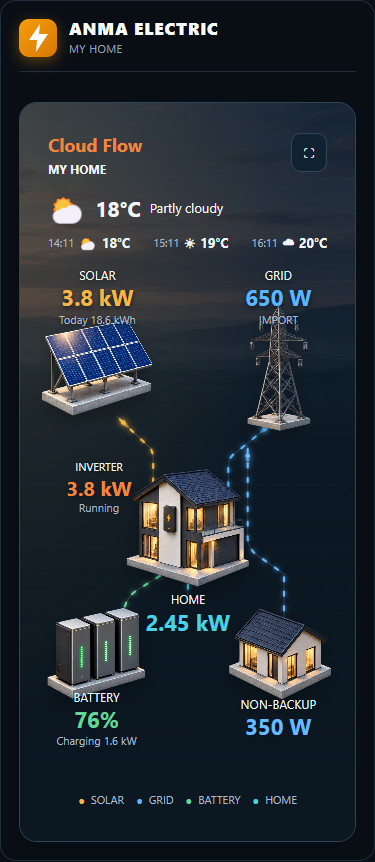

[Cloud Flow example](examples/cloud-flow-card.yaml) · [Weather setup](docs/CONFIGURATION.md#cloud-flow-weather)

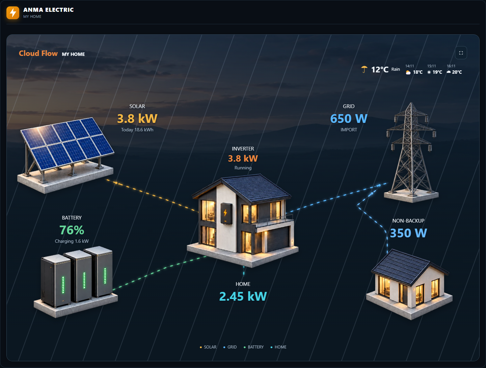 

## Choose your view

| View | Purpose |
| --- | --- |
| **Energy Station** | Configurable PV fields, individual batteries, GEN/AUX and appliance groups. |
| **ANMA Power Flow** | Equipment blocks with PV strings, batteries, grid and backup/non-backup supply. |
| **ANMA Cloud Flow** | Architectural energy scene, current weather and forecasts. |
| **Energy flows** | Flow diagram, system readings and measurement panels. |
| **Compact metrics** | Essential readings in a concise tile layout. |
| **Full System Analytics** | Flow overview, readings, weather, solar forecast and history in one scrollable view. |

### ANMA Power Flow

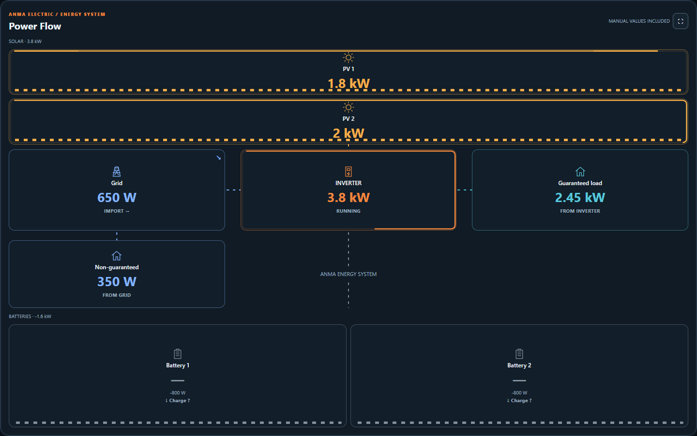

Individual equipment blocks and power indicators, with existing sensor bindings and boundary-to-boundary connections.

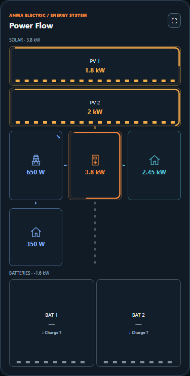

### Energy flows

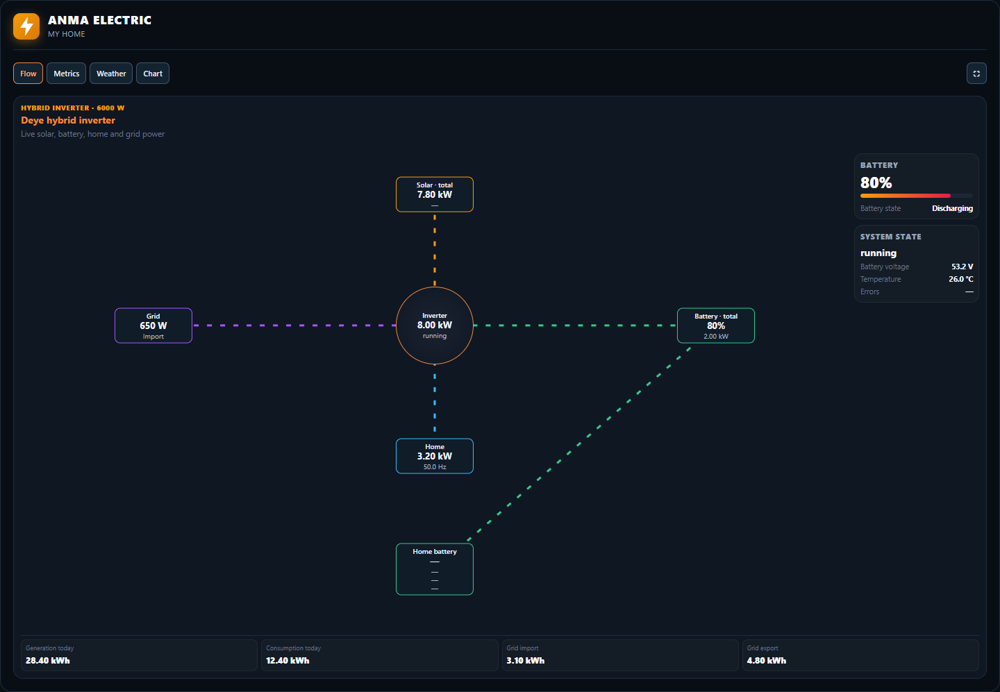

A system overview with selectable measurement panels.

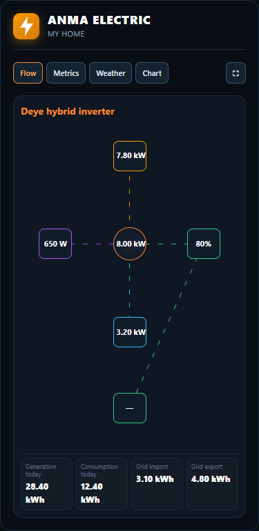

### Compact metrics

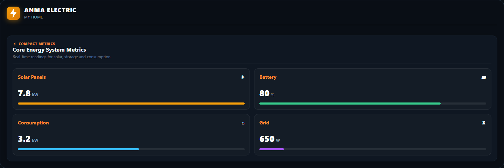

A concise view of generation, storage, consumption and grid readings.

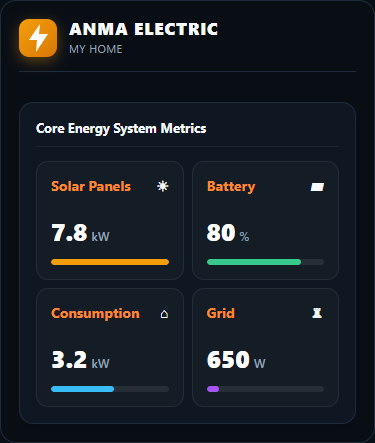

### Full System Analytics

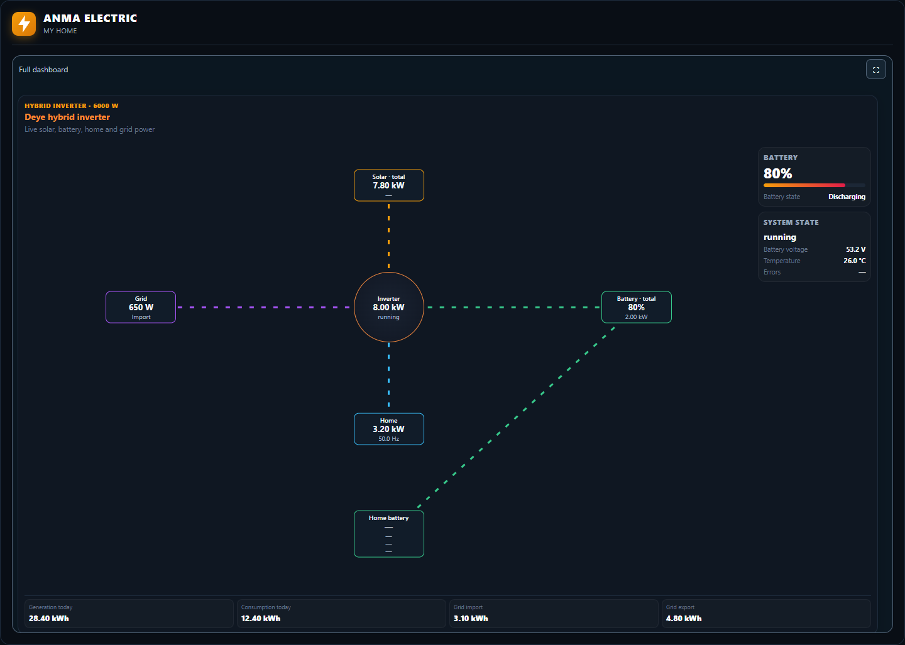

Scroll inside the dashboard to reach weather, forecast and history panels.

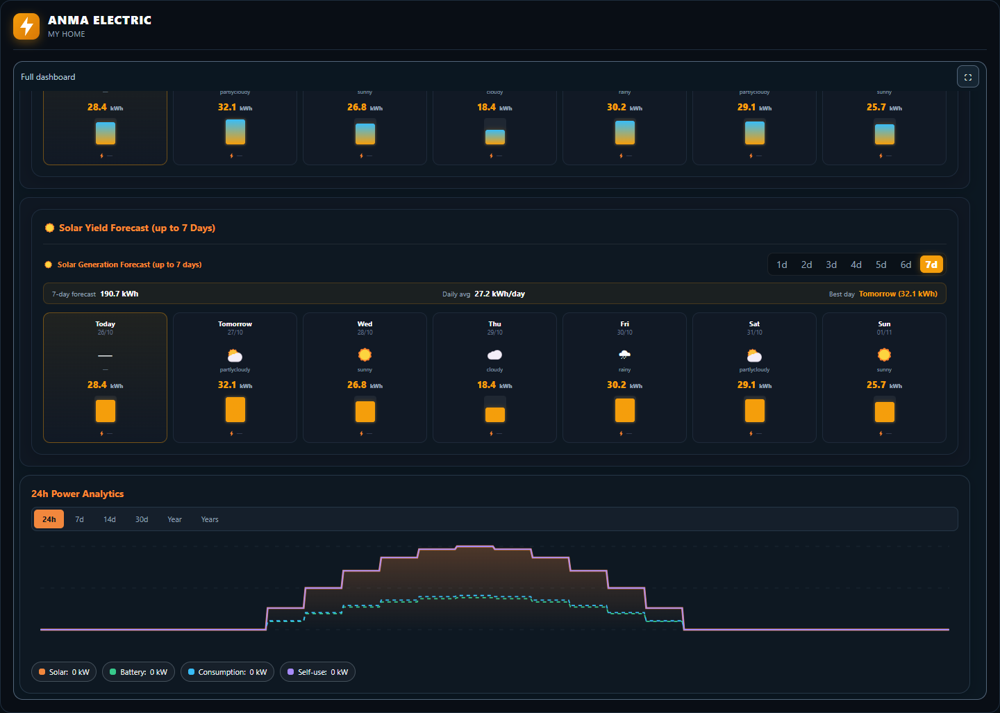

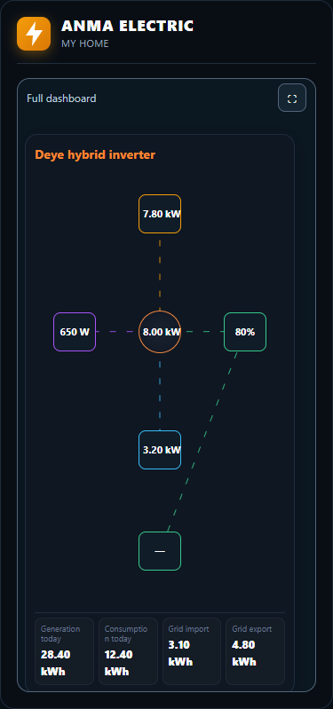

## Install with HACS

1. Open **HACS → Custom repositories**.
2. Add `https://github.com/bobantonbob/lovelace-anma-card`, category **Dashboard**.
3. Find **ANMA Energy Dashboards** and download it.
4. Check the resource `/hacsfiles/lovelace-anma-card/anma-card.js`, type **JavaScript module**.
5. Add a Manual card and paste the YAML exported by ANMA, or use an example.

Every dashboard uses `type: custom:anma-card`. Its `layout.template` selects the view. Cloud Flow's images are embedded in the resource, so it needs no extra asset downloads or card installation.

This is a HACS custom repository; inclusion in the default HACS catalog is a separate review.

### Manual installation

Download **anma-card.js**, or the manual-install ZIP, from the release. Copy the JS file to `/config/www/anma/anma-card.js`. Register `/local/anma/anma-card.js?v=0.7.0` as a JavaScript module. Update your existing ANMA resource when upgrading and keep one active resource.

## Connect your readings

Use existing power entities in W, kW or MW, and energy entities in Wh, kWh or MWh. Configure grid status separately: zero grid power alone does not establish an outage. Choose import/export and charge/discharge sign conventions that match your equipment.

Appliance readings describe their parent group; they are not added to the parent total a second time. Visibility changes the drawing, not the physical wiring. Missing live inputs stay unavailable. Preview examples use synthetic values; the installed card does not substitute those readings for your sensors.

[Configuration](docs/CONFIGURATION.md) · [Three-view dashboard example](examples/three-tab-dashboard.yaml) · [Validation](docs/VALIDATION.md)

## Gallery and compatibility

All gallery images above are freshly captured from the **0.7.0 standalone card**, using synthetic Home Assistant states, weather forecasts and history. Desktop captures use a 1440px viewport; phone captures use 375 × 812 and show the complete card, which may scroll vertically. They are browser previews, not physical iPhone certification.

Modern container-query support is required. Forecast capabilities depend on your weather provider, and history needs recorded Home Assistant data. The platform backend, sensors and device integrations are not installed by this frontend card.

## License

[MIT](LICENSE) · Copyright (c) 2026 Anton Babenko and ANMA contributors.
