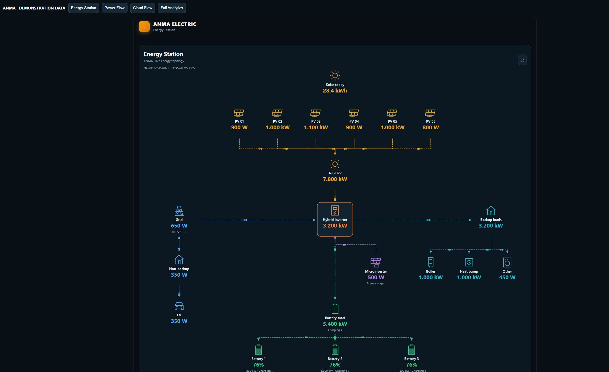
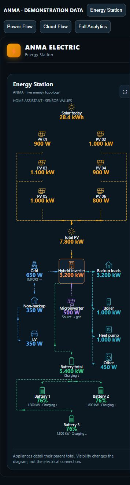
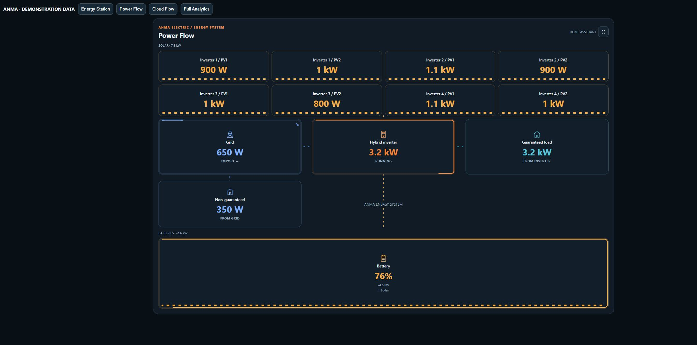
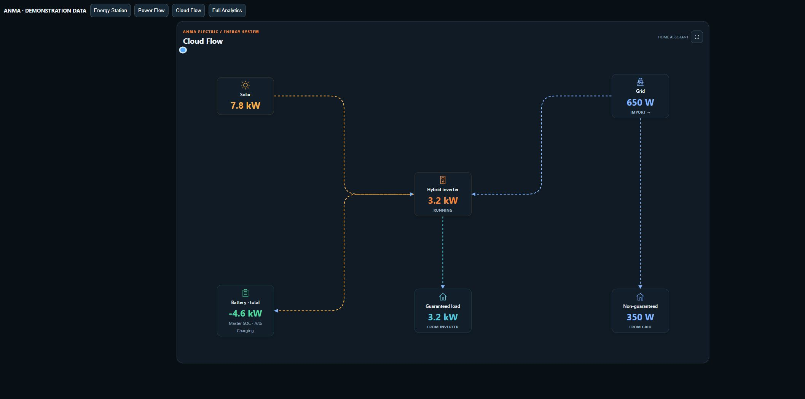
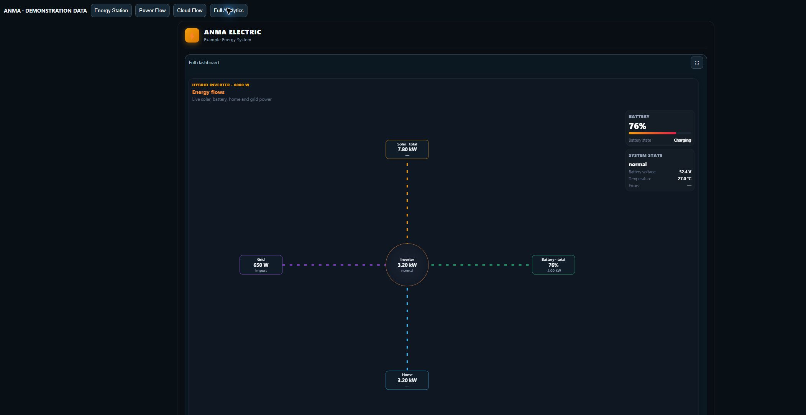

# ANMA Energy Dashboards

**Your solar, storage and home — one clear energy picture.**

Build an energy dashboard around your existing Home Assistant sensors. Start with **Energy Station**, choose the components you want to see and connect their entities. Follow solar production, battery charging, grid imports and exports, and the loads that matter to you.

**Latest release: 0.4.1** · [Download](https://github.com/bobantonbob/lovelace-anma-card/releases/latest) · [Configuration](docs/CONFIGURATION.md) · [Changelog](CHANGELOG.md)

## Start with Energy Station

- **Up to 10 PV fields and 5 batteries**, with individual sensor bindings.
- Today's solar energy above the PV fields and total solar power below them.
- Optional backup and non-backup load groups. Put an EV, boiler, heat pump, lighting or another appliance in the appropriate group.
- **GEN/AUX roles:** microinverter input, generator input, smart-load output or disabled. Microinverter flow runs toward its selected connection.
- Signed grid and battery power determine flow direction. Configure the sign convention used by your meter.
- A grid-status entity marks outages; the non-backup group becomes grey or can be hidden.
- Visible PV fields, batteries and appliance rows recenter when their count changes.
- Adaptive, wide, square and phone layouts, with light and dark appearance.

[Open the Energy Station example](examples/energy-station.yaml), replace its example entity IDs and add it as a Manual card in Home Assistant. Missing readings remain unavailable; the installed card does not substitute Energy Station demo values.

## Choose your view

| Dashboard | Best for |
| --- | --- |
| **Energy Station** | Configurable PV fields, individual batteries, GEN/AUX and appliance groups. |
| **ANMA Power Flow** | Equipment blocks with PV strings, batteries, grid and backup/non-backup loads. |
| **ANMA Cloud Flow** | A simpler six-node overview with directional energy paths. |
| **Energy flows** | An editable flow diagram and key measurements. |
| **Compact metrics** | A dense collection of essential readings. |
| **Full System Analytics** | Energy flows, metric tiles, weather, solar forecast and history in one scrolling view. |

### ANMA Power Flow

Power Flow shows individual equipment blocks and power indicators. Connections meet the block boundaries instead of crossing the readings. The web editor's **Connections** panel groups existing settings in a compact, scrollable drawer.

### ANMA Cloud Flow

A compact six-node diagram: solar, grid, inverter, battery total, guaranteed load and non-guaranteed load. Moving particles show direction, with fading trails along the connections.

### Full System Analytics

Combine a flow overview, measurements, forecasts and charts. History and forecasts need the corresponding Home Assistant integrations and data; screenshots are demonstrations, not a promise that every installation supplies those readings.

## Design on ANMA, display in Home Assistant

[ANMA Energy Platform](https://app.anma-electric.com.ua/) brings together an equipment knowledge base, product comparisons, System Builder and the dashboard editor. Design your layout, map entities and export it to the custom card.

This repository distributes the frontend card. It does not install the platform backend, create sensors or control your inverter. Website updates and card updates are separate: install a compatible card version when exporting a newer template.

## Install with HACS

1. Open **HACS → Custom repositories**.
2. Add `https://github.com/bobantonbob/lovelace-anma-card` with category **Dashboard**.
3. Find **ANMA Energy Dashboards** and download it.
4. Check the resource `/hacsfiles/lovelace-anma-card/anma-card.js`, type **JavaScript module**. Add it only if HACS has not registered it.
5. Reload Home Assistant, then add a Manual card using an example or your exported layout.

This repository is available through a custom repository; inclusion in the default HACS catalog is a separate review.

### Manual installation

Download **anma-card.js** from the latest release and copy it to `/config/www/anma-card.js`. Register `/local/anma-card.js?v=0.4.1` as a JavaScript module. Keep only one ANMA resource registered. When updating, replace the file and refresh your browser cache.

## Connect your readings

Use existing `sensor.*` and `binary_sensor.*` entities. Power sensors should report W, kW or MW; daily energy uses Wh, kWh or MWh. Configure a grid-status entity separately: zero grid power alone does not prove an outage.

Set the import/export and charging/discharging sign conventions to match your sensors. Individual appliance readings describe their parent group; do not add a parent total to its children a second time. Visibility controls change the diagram, not your physical wiring.

See [configuration](docs/CONFIGURATION.md), [the Energy Station example](examples/energy-station.yaml) and [the existing three-view example](examples/three-tab-dashboard.yaml). Save your dashboard YAML after editing.

## Screenshots and compatibility

The gallery uses the actual standalone 0.4.1 card with synthetic Home Assistant states. Phone images are browser viewport previews, not physical-device certification. Existing layouts and entity bindings are preserved. Modern CSS container-query support is required; fullscreen availability depends on the browser.

Read [validation](docs/VALIDATION.md), [publishing](docs/PUBLISHING.md) and [release notes](CHANGELOG.md).

## License

[MIT](LICENSE) · Copyright (c) 2026 Anton Babenko and ANMA contributors.
