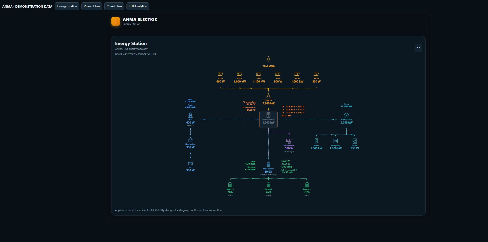
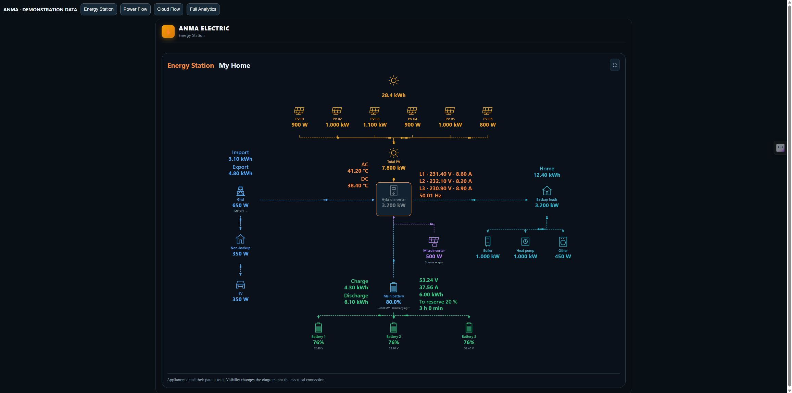

# ANMA Energy Dashboards

**Your solar, storage and home — one clear energy picture.**

Build an energy dashboard around your existing Home Assistant sensors. Start with **Energy Station**, choose the components you want to see and connect their entities. Follow solar production, battery charging, grid imports and exports, and the loads that matter to you.

**Latest release: 0.6.9** · [Download](https://github.com/bobantonbob/lovelace-anma-card/releases/latest) · [Configuration](docs/CONFIGURATION.md) · [Changelog](CHANGELOG.md)

## Start with Energy Station

- **Up to 10 PV fields and 5 batteries**, with individual sensor bindings.
- Today's solar energy above the PV fields and total solar power below them.
- Optional backup and non-backup load groups. Put an EV, boiler, heat pump, lighting or another appliance in the appropriate group.
- **GEN/AUX roles:** microinverter input, generator input, smart-load output or disabled. Microinverter flow runs toward its selected connection.
- Signed grid and battery power determine flow direction. Configure the sign convention used by your meter.
- A grid-status entity marks outages; the non-backup group becomes grey or can be hidden.
- Visible PV fields, batteries and appliance rows recenter when their count changes.
- Adaptive, wide, square and phone layouts, with light and dark appearance.

[Open the Energy Station example](examples/energy-station.yaml), replace its example entity IDs and add it as a Manual card in Home Assistant. Missing readings remain unavailable; the installed card does not substitute Energy Station demo values.

## Choose your view

| Dashboard | Best for |
| --- | --- |
| **Energy Station** | Configurable PV fields, individual batteries, GEN/AUX and appliance groups. |
| **ANMA Power Flow** | Equipment blocks with PV strings, batteries, grid and backup/non-backup loads. |
| **ANMA Cloud Flow** | A simpler six-node overview with directional energy paths. |
| **Energy flows** | An editable flow diagram and key measurements. |
| **Compact metrics** | A dense collection of essential readings. |
| **Full System Analytics** | Energy flows, metric tiles, weather, solar forecast and history in one scrolling view. |

### ANMA Power Flow

Power Flow shows individual equipment blocks and power indicators. Connections meet the block boundaries instead of crossing the readings. The web editor's **Connections** panel groups existing settings in a compact, scrollable drawer.

### ANMA Cloud Flow

A compact six-node diagram: solar, grid, inverter, battery total, guaranteed load and non-guaranteed load. Moving particles show direction, with fading trails along the connections.

### Full System Analytics

Combine a flow overview, measurements, forecasts and charts. History and forecasts need the corresponding Home Assistant integrations and data; screenshots are demonstrations, not a promise that every installation supplies those readings.

## Design on ANMA, display in Home Assistant

[ANMA Energy Platform](https://app.anma-electric.com.ua/) brings together an equipment knowledge base, product comparisons, System Builder and the dashboard editor. Design your layout, map entities and export it to the custom card.

This repository distributes the frontend card. It does not install the platform backend, create sensors or control your inverter. Website updates and card updates are separate: install a compatible card version when exporting a newer template.

## Install with HACS

1. Open **HACS → Custom repositories**.
2. Add `https://github.com/bobantonbob/lovelace-anma-card` with category **Dashboard**.
3. Find **ANMA Energy Dashboards** and download it.
4. Check the resource `/hacsfiles/lovelace-anma-card/anma-card.js`, type **JavaScript module**. Add it only if HACS has not registered it.
5. Reload Home Assistant, then add a Manual card using an example or your exported layout.

This repository is available through a custom repository; inclusion in the default HACS catalog is a separate review.

### Manual installation

Download **anma-card.js** from the latest release and copy it to `/config/www/anma-card.js`. Register `/local/anma-card.js?v=0.6.9` as a JavaScript module. Keep only one ANMA resource registered. When updating, replace the file and refresh your browser cache.

## Connect your readings

Use existing `sensor.*` and `binary_sensor.*` entities. Power sensors should report W, kW or MW; daily energy uses Wh, kWh or MWh. Configure a grid-status entity separately: zero grid power alone does not prove an outage.

Set the import/export and charging/discharging sign conventions to match your sensors. Individual appliance readings describe their parent group; do not add a parent total to its children a second time. Visibility controls change the diagram, not your physical wiring.

See [configuration](docs/CONFIGURATION.md), [the Energy Station example](examples/energy-station.yaml) and [the existing three-view example](examples/three-tab-dashboard.yaml). Save your dashboard YAML after editing.

## Screenshots and compatibility

The gallery uses the actual standalone 0.4.1 card with synthetic Home Assistant states. Phone images are browser viewport previews, not physical-device certification. Existing layouts and entity bindings are preserved. Modern CSS container-query support is required; fullscreen availability depends on the browser.

Read [validation](docs/VALIDATION.md), [publishing](docs/PUBLISHING.md) and [release notes](CHANGELOG.md).

## License

[MIT](LICENSE) · Copyright (c) 2026 Anton Babenko and ANMA contributors.

## Energy Station telemetry (0.5.0)

Measurements are displayed beside their devices: individual battery SOC and decimal voltage, main battery telemetry and daily counters, grid totals and tariff, house consumption and inverter diagnostics. Configure the optional sensors in Connections.

## New in 0.6.0

Choose single-phase or three-phase inverter readings and customize flow colors, including separate battery charge/discharge colors. The diagram shows compact device-colored readings, usable energy above your reserve SOC and estimated battery-only autonomy at the current backup load. Demo mode reveals all available telemetry before you connect entities.

## 0.6.4 — One ANMA card for all dashboards

Install one HACS package and use `type: custom:anma-card` for every dashboard. The exported `layout.template` selects Energy Station, ANMA Power Flow, ANMA Cloud Flow, Energy flows, Compact metrics or Full System Analytics. No additional card installation or YAML type editing is required.

The shared card now forwards configuration and live Home Assistant states to the current renderer even when a legacy card element was registered first. Energy Station settings remain selected by template. Responsive sizing is rechecked when the card becomes visible or its container changes size.

This supersedes the separate-type recommendation in 0.6.3. Previously exported Energy Station aliases remain supported for compatibility. Entity bindings are preserved.

Validation: 17 automated runtime and Energy Station tests passed; Django system checks passed. Browser verification used an intentionally pre-registered legacy card and the public `anma-card` element.

## 0.6.5 — Energy Station viewport sizing

Removed the fixed 650px diagram limit. Fitted Energy Station cards now use the available viewport height below their position; fullscreen uses the full viewport with the diagram filling the space between its heading and footer. Resizing recalculates the available height. SVG proportions, entity bindings and the single custom:anma-card entry point are preserved.

Validation: 17 automated tests and Django checks passed. Normal browser sizing was measured at 984px card height / 830px diagram height in a 1156px viewport. Native fullscreen activation was denied by the test browser and needs verification in Home Assistant.

## 0.6.6 — Battery reserve runtime

The displayed reserve runtime now uses actual signed battery discharge power, rather than the backup-load total which may contain only a subset of appliances. Charging, idle and unavailable battery readings show no depletion estimate. Capacity and entity bindings are unchanged.

Regression case: 18 kWh nominal capacity, 89% SOC, 10% reserve, 1.02 kW battery discharge and 233 W appliance load gives 14.22 kWh usable energy and approximately 13 h 56 min. 18 tests and Django system checks passed.

## 0.6.7 — Energy Station appearance controls

Connections now includes a system name beside the orange Energy Station heading and background opacity from 0% (transparent) to 100% (opaque). Only the background fill fades; text, icons and flows remain opaque. The system name follows the foreground theme for readability. Removed the secondary heading and sensor-source subtitle.

Telemetry labels and values use 20px SVG text; inverter temperature captions are AC and DC. Expanded mobile spacing for inverter readings, including three-phase data. Settings survive website YAML export and the single custom:anma-card runtime.

Validation: 19 automated tests, Django system checks, desktop appearance and a 390px mobile viewport. Entity bindings and calculation logic are preserved.

## 0.6.8 — Slider, mobile inverter readings and system name

Background opacity now uses a slider with percentage feedback. AC and DC temperatures each occupy one compact line. Phone inverter readings are centered below the inverter, ahead of the microinverter; auxiliary and battery paths bypass the text.

General settings now expose the system name shown beneath the fixed ANMA ELECTRIC brand. The brand square uses an explicit lightning SVG instead of a platform emoji. Existing bindings and calculations are preserved. 19 tests and Django checks passed; desktop/mobile DOM placement was checked in a browser.

# 0.6.9 — Solar forecast and desktop telemetry

Energy Station accepts a daily solar forecast entity in Connections → Solar. Below the sun, actual production is shown to the left of a centered slash and the daily forecast to the right. Energy entities are converted from Wh, kWh or MWh; an unavailable forecast remains unknown. Existing layouts without a forecast retain their production reading.

Desktop temperature captions now read `AC 46 °C` and `DC 41 °C`. Temperature readings sit to the left of the inverter, voltage/current to the right at the same height, and frequency inside its upper corner. Diagram text is increased by 2px on desktop; phone text sizes and inverter telemetry placement remain unchanged.

The single `custom:anma-card` entry point, entity bindings and battery calculations are preserved. Website YAML exports retain the forecast setting.

Validation: 20 automated tests and Django system checks passed. Browser checks covered centered forecast values, desktop 22px readings, and phone 20px readings with three phases and no horizontal overflow.
