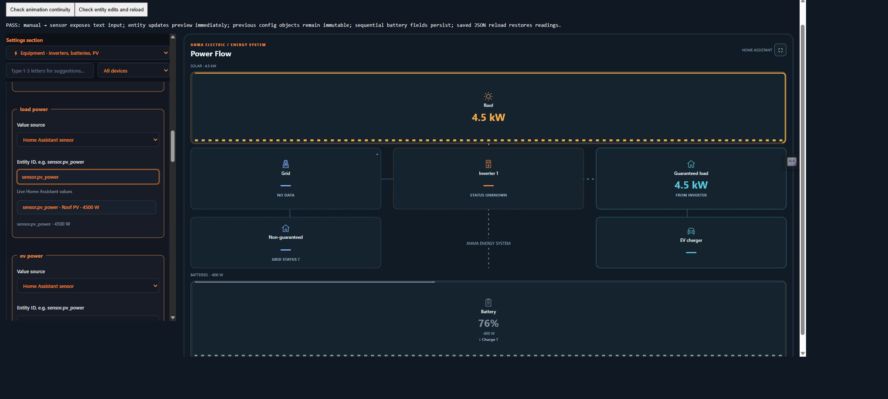
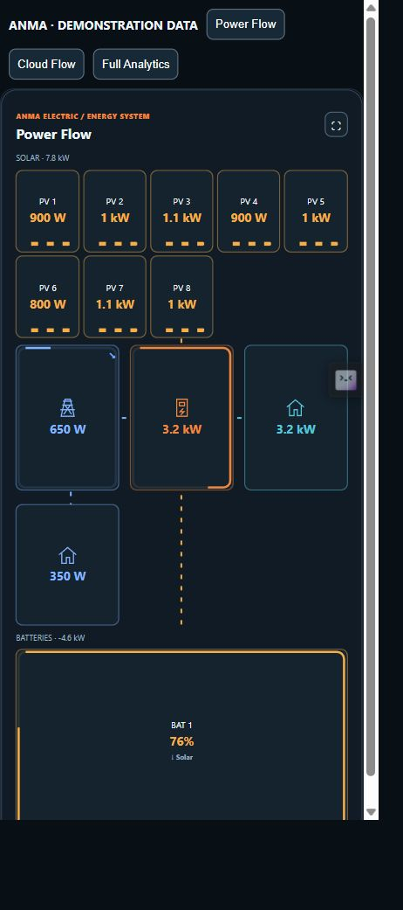
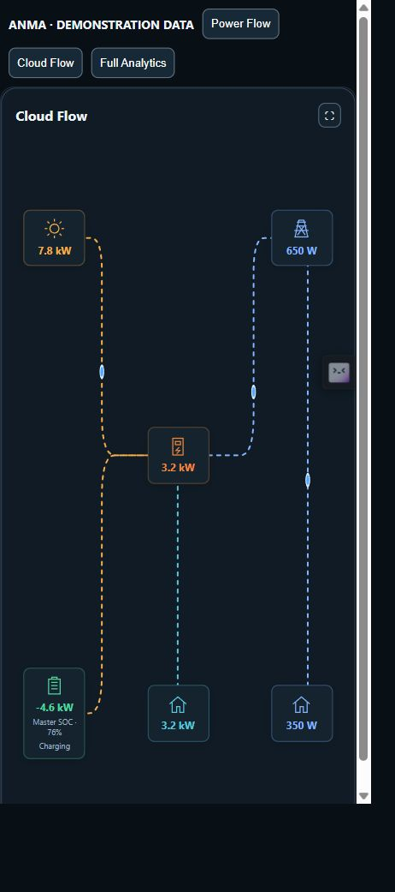
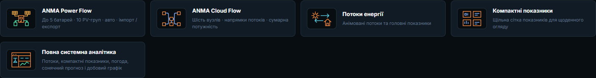
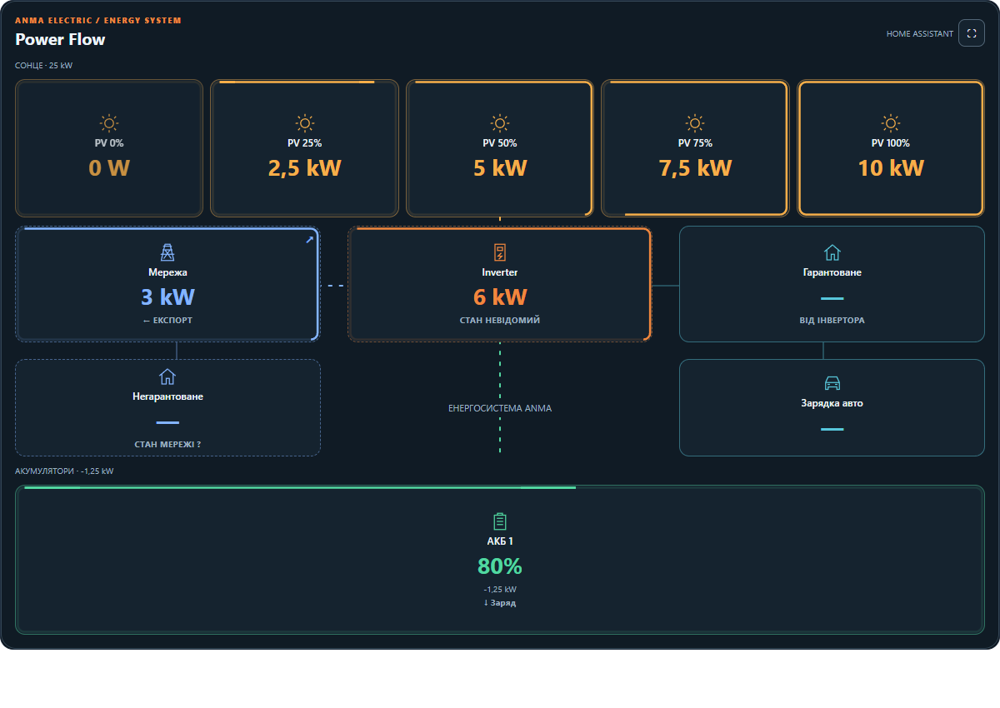

# Screenshot gallery

## Home Assistant entity editor (beta.2)

This local harness uses the actual custom card editor with synthetic Home Assistant states and configuration echo behavior.

New English screenshots below were captured from the packaged JavaScript in a local browser preview using synthetic entity states. They demonstrate the real renderer, not image mockups, and do not expose a private Home Assistant installation.

## Power Flow — eight strings, one battery

## Cloud Flow — six directional nodes

## Full analytics — first section of the scrolling dashboard

The preview has no Home Assistant Recorder or forecast service. Missing history and forecast data are intentionally not presented as real observations.

## Phone previews

## Earlier development captures

These historical captures show UI iteration with demonstration data and Ukrainian labels. They may differ from the final English configuration.

